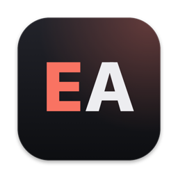
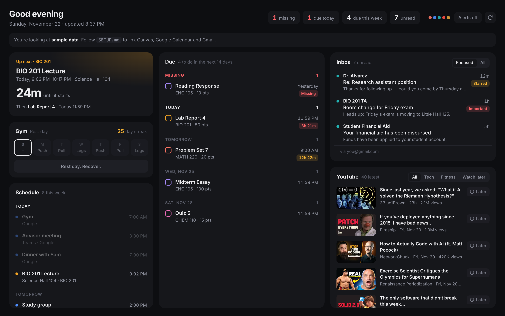
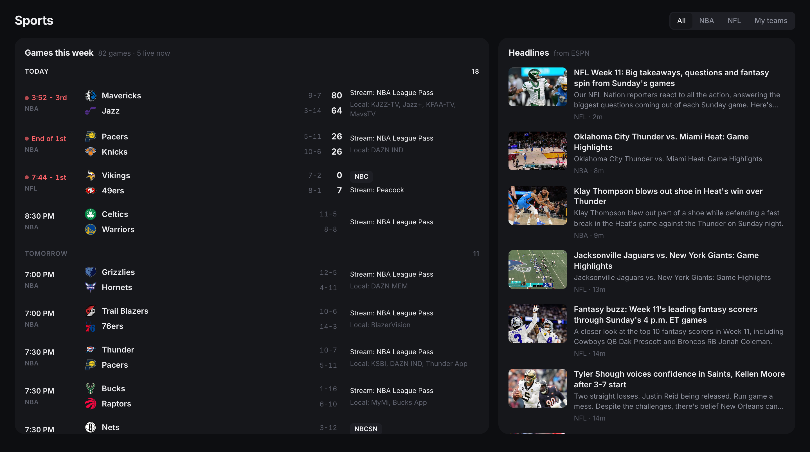
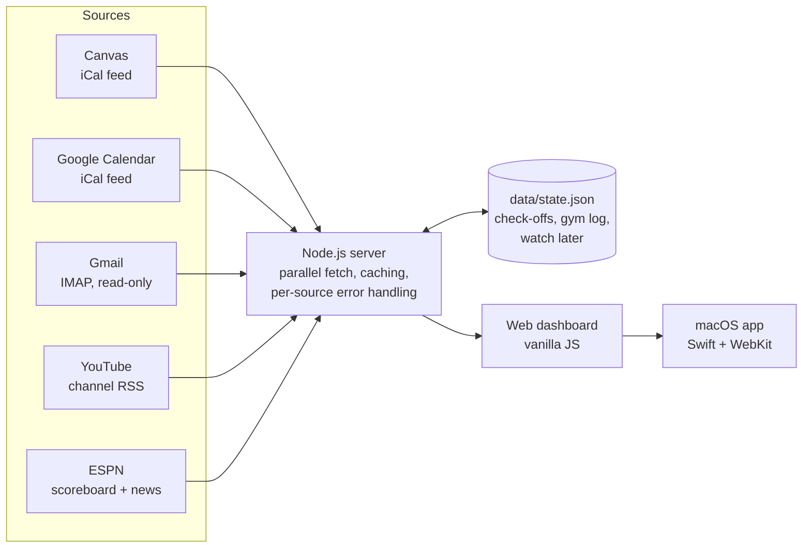

<p align="center">
  
</p>

<h1 align="center">EasyAccess</h1>

<p align="center">
  A personal command center for a student's day: classes, deadlines, email, workouts, videos and sports in one screen.<br>
  Runs locally on macOS as a native app or in the browser.
</p>



## Why I built this

<!-- ✏️ Rewrite this section in your own words. It's the part readers trust most when it sounds like you. -->

As a first-year engineering student, I was checking Canvas, Google Calendar, my school email and a handful of
other apps all day just to know what was coming up next. I wanted one screen I could glance at between classes
that answers "what do I have to do, and when?", plus the things I actually care about outside of class:
staying consistent at the gym, keeping up with tech and fitness videos, and getting into the NBA and NFL.

## Features

- **Up next:** a live countdown to the next class, meeting or deadline, with a progress bar while something is happening.
- **Due:** every Canvas assignment for the next two weeks, grouped by day, colour-coded by course, with urgency
  badges. Check items off as you finish them.
- **Schedule:** classes and events from Google Calendar and Canvas, with recurring events expanded.
- **Inbox:** recent email from Gmail, with a *Focused* view that hides newsletters. It opens the mailbox read-only,
  so it never marks anything as read.
- **Gym tracker:** a configurable weekly routine (push/pull/legs by default), one-click logging and a streak that
  counts rest days correctly.
- **YouTube:** the newest full-length videos from chosen fitness and tech channels (Shorts filtered out), plus a
  *Watch later* list that keeps a video after it drops off the feed.
- **Sports:** every NBA/NFL game this week with live scores, records and **where to watch**: the national network,
  the streaming app that carries it, and whether it's regional or local-only.
- **Native macOS app:** its own window and Dock icon, Mac notifications 10 minutes before events, and an animated
  "EASY ACCESS" splash while data loads.
- **Resilient by design:** every source loads in parallel and fails independently, so one service being down never blanks
  the page. Status dots show what's connected.



## How it works



- **`server.js`** is a small Node.js HTTP server, with no framework, bound to `localhost`. It fetches all sources in
  parallel, normalizes them into one shape (events, assignments, emails, videos, games), caches them, and serves
  a single JSON payload. Recurring calendar events are expanded with `node-ical`.
- **`public/`** is the dashboard: plain HTML, CSS and JavaScript. It refreshes every 2 minutes, and anything new
  since your last look is tagged **NEW**.
- **`desktop/`** holds a single-file Swift app (AppKit + WKWebView). It starts the server, shows the dashboard, opens
  links in your browser and bridges the page's alerts to native macOS notifications.
- Everything you set on the page is saved in a local JSON file, written atomically.

**Privacy:** it runs entirely on your machine. Credentials live in a git-ignored `.env`, the server only accepts
requests from `localhost`, and write requests need a custom header, so other websites can't trigger them.

## Getting started

Requires **Node.js 22+** and macOS for the native app. The web dashboard works anywhere.

```bash
git clone <this repo> EasyAccess && cd EasyAccess
npm install
cp .env.example .env      # add your calendar links, Gmail app password, etc.
npm start                 # → http://localhost:3000
./desktop/build.sh        # optional: build EasyAccess.app
```

With no links configured, it runs on **sample data**, so you can try it immediately.
See **[SETUP.md](SETUP.md)** for step-by-step instructions for each source.

## Tech

JavaScript (Node.js), HTML/CSS, Swift (AppKit, WebKit, UserNotifications), REST/RSS/iCalendar/IMAP integrations.
Dependencies: [`node-ical`](https://github.com/jens-maus/node-ical), [`imapflow`](https://github.com/postalsys/imapflow),
[`mailparser`](https://github.com/nodemailer/mailparser).

*The screenshots use the app's built-in sample data. Sports and YouTube data are live.
The sports data comes from ESPN's public site API, which isn't official or documented.*
# EasyAccess-Dashboard
